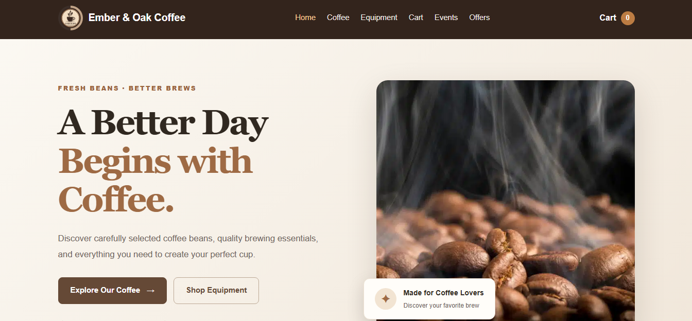
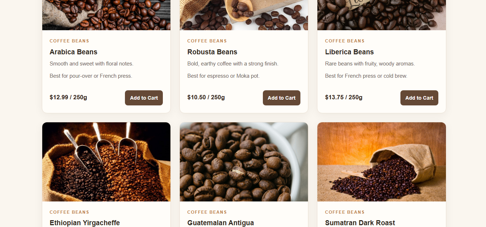
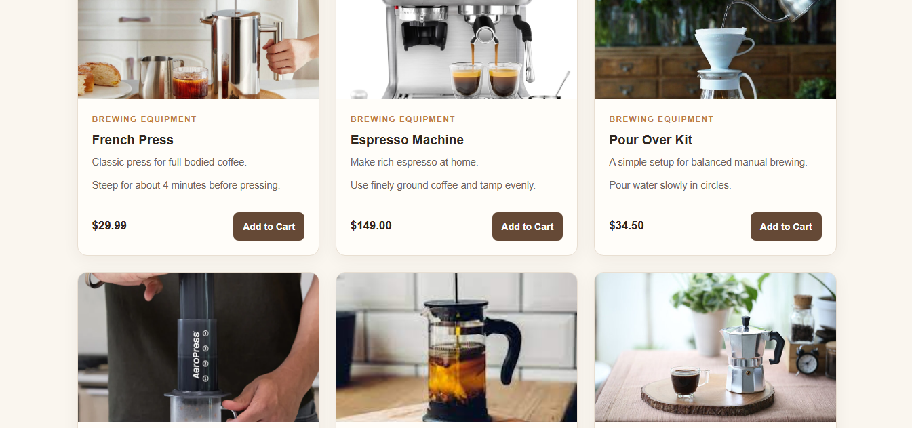
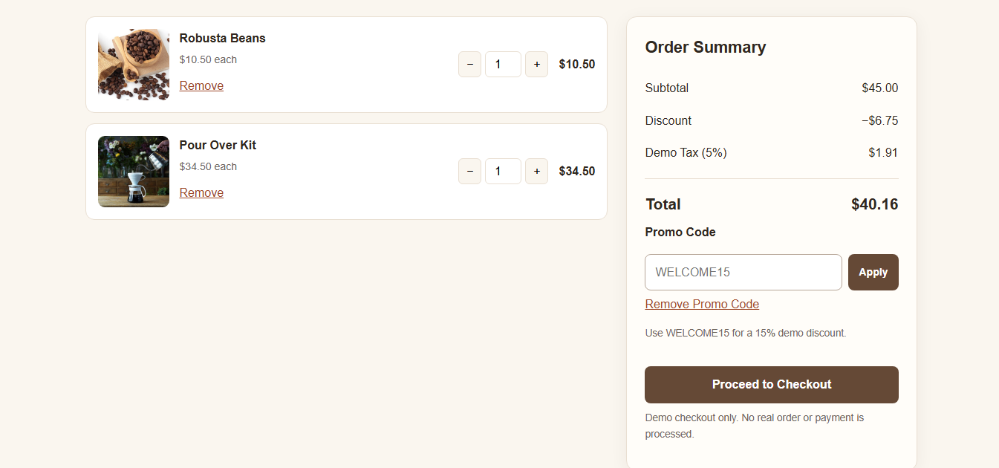

# [Ember & Oak Coffee](https://github.com/Ei359/ember-oak-coffee)

Ember & Oak Coffee is a coffee shopping website I built using HTML, CSS, and JavaScript. It lets visitors explore different coffee beans, browse brewing equipment, and manage products in a shopping cart.

I built it around a simple online shopping experience. Visitors can explore the product collections, search for items they are interested in, add products to their cart, and adjust quantities before reviewing their order. I also included an events page and a special offers section to make the website feel more like a complete coffee shop experience.


## Website Preview

### 1. Home Page

The homepage introduces Ember & Oak Coffee, with a main banner, featured product cards, and links to the coffee and equipment collections. It provides a starting point for exploring the website.



### 2. Explore Coffee Beans

Browse six coffee varieties, including Arabica, Robusta, Liberica, Ethiopian Yirgacheffe, Guatemalan Antigua, and Sumatran Dark Roast. Each product includes an image, description, price, and search functionality.



### 3. Explore Brewing Equipment

Browse six brewing products, including French Press, Espresso Machine, Pour Over Kit, AeroPress, Cold Brew Maker, and Moka Pot. Each card provides product information and an option to add the item to the shopping cart.



### 4. Manage the Shopping Cart

Add products to the cart, increase or decrease quantities, and remove items. The cart displays the selected products and updates the order total as quantities change. Cart information is saved using browser local storage.



## Features

### 1. Homepage and Navigation

- Browse a homepage with featured products and promotional sections.
- Navigate between Home, Coffee, Equipment, Cart, Events, and Offers.
- View a shopping cart counter across the website.
- Explore product categories through dedicated sections.

### 2. Coffee and Equipment Collections

- Browse six coffee bean varieties and six brewing equipment products.
- View product images, descriptions, and prices.
- Search for products by name or relevant keywords.
- Add selected products to the shopping cart.

### 3. Shopping Cart

- Add products to the cart.
- Increase or decrease product quantities.
- Remove products from the cart.
- Automatically update item totals and order calculations.
- Display the total number of items in the cart.
- Preserve cart information using browser local storage.

### 4. Special Offers

- Explore sample coffee promotions.
- View example subscription plans.
- Use the WELCOME15 demo discount code to test the cart discount.
- Navigate to the shopping cart to review the discount.

### 5. Coffee Events and Workshops

- Explore sample coffee tasting sessions.
- Discover brewing technique workshops.
- View coffee roasting experiences.
- Complete a demo event registration form with input validation.

### 6. Additional Website Features

- Responsive navigation and page layouts.
- Consistent header and footer across website pages.
- Newsletter signup demonstration.
- Welcome popup with a promotional discount code.
- Search functionality for product collections.

## Technologies Used

| Technology | How I used it |
| --- | --- |
| HTML5 | Creating the structure of the homepage, product pages, cart, events, and offers |
| CSS3 | Designing the website layout, product cards, navigation, footer, and responsive styles |
| JavaScript | Implementing product search, shopping cart interactions, quantity controls, and form validation |
| Browser LocalStorage | Saving shopping cart information between page visits |
| Git | Tracking project changes and maintaining versions |
| GitHub | Hosting and sharing the project source code |

## Getting Started

### Requirements

- A web browser
- Visual Studio Code
- Live Server extension
- Git if you want to clone the repository

### Installation

1. On the GitHub repository page, click **Code** and copy the HTTPS URL. In your terminal, run:

   ```bash
   git clone https://github.com/Ei359/ember-oak-coffee.git
   ```

2. Open the downloaded Ember & Oak Coffee folder in Visual Studio Code.

3. Install the Live Server extension if you haven't already.

4. Open `index.html` and select **Open with Live Server**.

5. Explore the website using the navigation menu.

## Try the Website

1. Open the homepage and explore the featured products.
2. Select **Coffee** to browse the available coffee beans.
3. Select **Equipment** to explore brewing products.
4. Click **Add to Cart** on a product you want to select.
5. Open **Cart** to review your selected products.
6. Increase or decrease the product quantities and check the updated totals.
7. Try the WELCOME15 demo discount code.
8. Visit **Events** to explore workshops and test the registration form.
9. Open **Offers** to view the promotional concepts and subscription plans.

## Project Structure

```text
ember-oak-coffee/
│
├── index.html
├── coffee.html
├── equipment.html
├── cart.html
├── events.html
├── offers.html
│
├── css/
│   ├── style.css
│   └── footer.css
│
├── js/
│   ├── products.js
│   ├── main.js
│   └── footer.js
│
├── image/
│   └── Website images
│
├── screenshots/
│   ├── homepage.png
│   ├── coffee-page.png
│   ├── equipment-page.png
│   └── cart.png
│
└── README.md
```

## Data Storage and Project Limitations

The shopping cart uses browser LocalStorage to preserve selected products and quantities. The saved cart is available in the same browser profile and website origin where the products were added.

This is a frontend demonstration project. It does not currently include a backend server, database, or real payment processing.

- The checkout process is for demonstration purposes.
- The WELCOME15 code demonstrates a shopping cart discount.
- Event registration does not create real bookings.
- Newsletter information is not sent or stored.
- Subscription plans and promotional offers are sample website content.

## What I Learned

Through this project, I gained practical experience in:

- Structuring a multi-page website using HTML.
- Designing consistent layouts using CSS.
- Creating responsive product cards and navigation.
- Using JavaScript for interactive website functionality.
- Managing shopping cart items and quantities.
- Working with browser LocalStorage.
- Implementing product search and form validation.
- Organizing CSS, JavaScript, images, and HTML into separate folders.
- Using Git and GitHub to manage and share a development project.

## What I Plan to Improve

- Connect the website to a backend and database.
- Add user registration and login functionality.
- Implement a real checkout and payment system.
- Introduce product stock management.
- Improve order management and customer functionality.

## About This Project

I built Ember & Oak Coffee to practise frontend web development and understand how different website components work together in an online shopping experience.

One of the main parts I focused on was the shopping cart. I wanted product selections and quantities to remain consistent while visitors moved between different pages. Working on this helped me understand JavaScript interactions, LocalStorage, and how to organize a multi-page website into separate HTML, CSS, and JavaScript files.

## Developer

**Ei Thazin Khine**

GitHub: [Ei359](https://github.com/Ei359)
